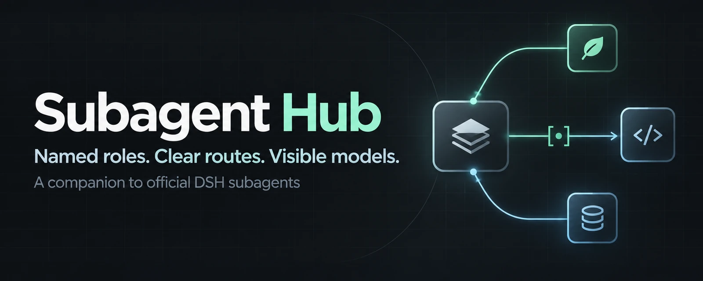
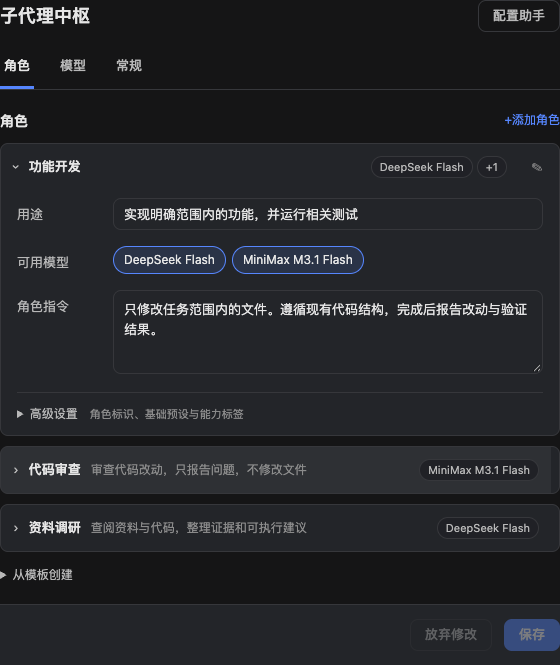
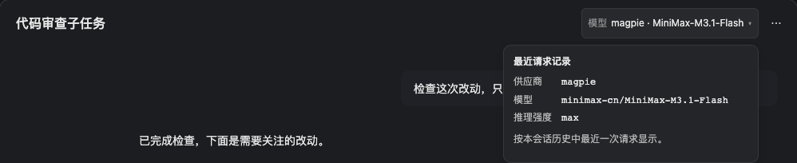
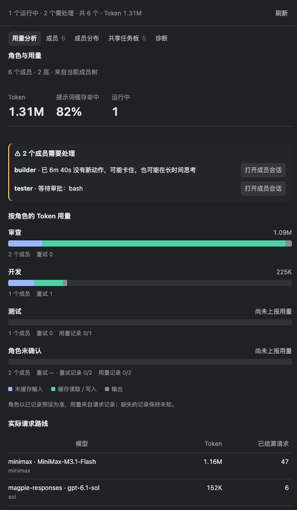
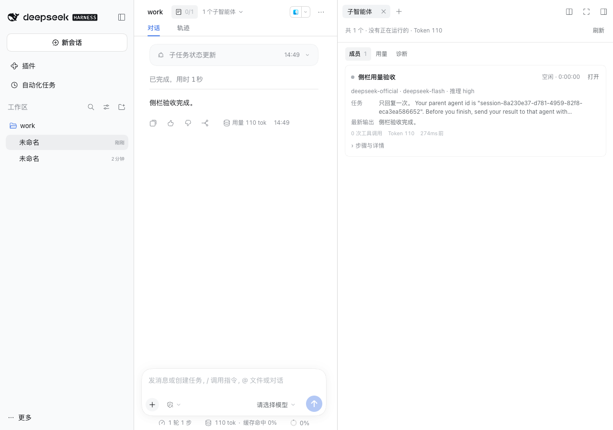
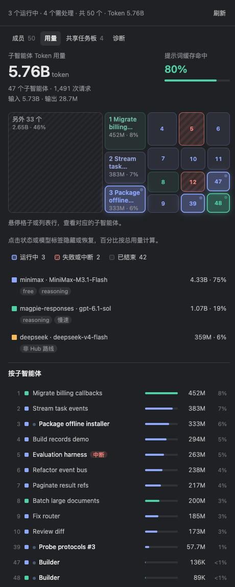
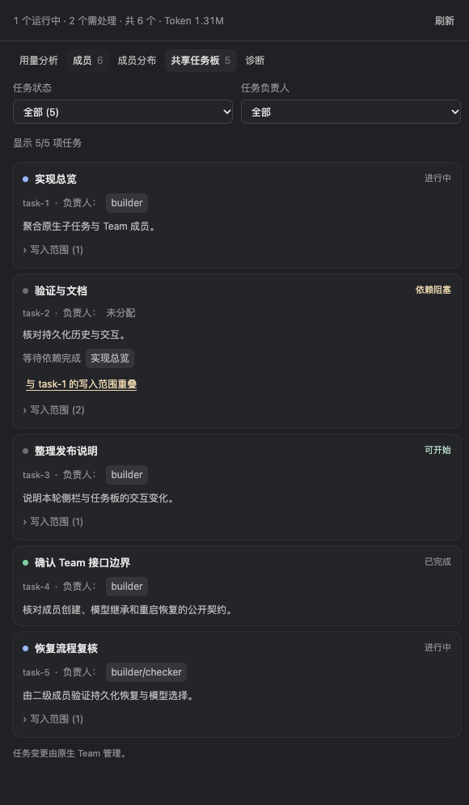

<p align="center">
  
</p>

<p align="center">
  <a href="https://github.com/ccsert/dsh-subagent-hub/releases/tag/v0.14.0"></a>
  <a href="LICENSE"></a>
  <a href="docs/install.md"></a>
  <a href="CONTRIBUTING.md"></a>
</p>

<p align="center"><b>简体中文</b> · <a href="README.en.md">English</a></p>

# Subagent Hub

0.14.0 支持 rc.2 原生具名委派，并改进设置页和子智能体总览。详见 [rc.2 兼容与验收](docs/compatibility-rc2.md)。

给 DeepSeek Harness 的官方子 agent 补上**角色、模型选择信息和路由边界**。主 agent 可以找到适合的审查、测试或调研角色；你可以在设置里维护允许的模型，并在子会话中查看最近请求用了哪个模型。

沿用官方 `subagent` / `subagent_fork`、Agent Presets 和会话界面，安装后继续使用原来的主会话预设。

**跨模型协作：** rc.2 使用原生 `subagent` / `subagent_fork`；`name` 是成员身份，`agent_preset` 是角色。rc.1 保留 `hub_spawn_teammate`。0.13.0 的真实 Qoder 验证属于历史记录，详见 [Team 模型路由](docs/team-model-routing.md)。

[安装](docs/install.md) · [下载 Release](https://github.com/ccsert/dsh-subagent-hub/releases/latest) · [配置示例](examples/subagent-hub.yml) · [变更记录](CHANGELOG.md) · [贡献指南](CONTRIBUTING.md)

## 可以做什么

| 能力 | 实际行为 |
|---|---|
| **具名子 agent** | 将角色注册成官方 `hub-agent-<id>` 预设，通过 `agent_preset` 派发 |
| **模型选择目录** | 向主 agent 提供路由、用途、能力标签和角色说明 |
| **路由约束** | 在 `subagent`、`subagent_fork`、Team 创建时检查全局路由范围，具名角色可进一步收紧 |
| **会话并发上限** | 限制一个父会话同时运行的子 agent 数量，与官方全局容量同时生效 |
| **原生配置表单** | 在 **设置 → 子代理中枢** 按角色、模型、常规分区配置；角色和模型支持搜索、折叠与排序，模型还可按供应商筛选 |
| **配置助手模式** | 使用「Hub 配置助手」设计角色和调整设置，先预览再保存，界面与助手编辑同一份配置 |
| **跨模型 Team** | rc.2 使用原生具名委派；rc.1 使用 `hub_spawn_teammate` |
| **请求模型可见** | 子会话标题栏显示最近请求的供应商与模型，展开读取完整 id 与推理强度 |
| **路线推理强度** | 每条路线可设默认 `reasoning_effort`；主 agent 漏传时 Hub 拒绝并给出精确重试写法，显式值优先 |
| **子智能体总览**（可选） | 标题栏实时监控：每个子 agent 的任务、当前动作、计划、汇报、模型与推理强度，按路线的 Token 用量，新结果与可能卡住提醒；默认关闭 |

## 子智能体总览

可选的 **子智能体总览** 默认关闭。在「设置 → 子代理中枢 → 常规」打开「显示子智能体总览」并保存，标题栏入口随即显示；关闭后仍可使用官方智能体团队界面。

总览作为官方右侧栏中的页签打开，与对话并排显示。侧栏的尺寸、收起、关闭、分屏与会话切换由 DSH 管理：

- **入口即状态**：按钮显示运行数；有子 agent 等待审批、一小时内中断或失败、或疑似卡住时变黄；关闭面板期间有子 agent 完成回合或发来汇报时显示蓝色计数。
- **卡片回答“它在干什么”**：任务、正在调用的工具与计时、审批等待、自己的计划进度、最近汇报或输出、模型与实际推理强度（含“模型默认”）；展开可见最近 12 步时间线。
- **用量分析**（默认页）按公开预设投影归组角色，展示输入、缓存、输出、重试覆盖及实际路线；配置对照仅比较当前配置与历史最近请求，差异不代表失败。缺失用量保持未知、估算标注，路线记录少于会话总量时明确披露。**成员分布页**按每次请求实际使用的路线统计子 agent 的 Token、请求数与缓存命中率，矩形树图按路线着色，排名与列表联动，并显示 Hub 路线标签。点击状态或模型标签可隐藏、恢复对应项目，图表和列表同步筛选，支持全部显示；总用量保持不变，另列筛选后的用量。Team 空闲成员与已结束任务分别显示。
- **可能卡住**：运行中超过 5 分钟无任何动作，或单个工具运行超过 15 分钟时提示。

活动摘要来自插件自己的会话投影 `subagentHubActivity`，从持久化历史折叠：只记录工具的描述性短字段，不存命令行或文件内容。共享任务板只在 Team 任务板有任务时显示，支持状态与负责人组合筛选、前置或冲突任务定位，以及打开真实负责人会话；就绪、阻塞和写入冲突直接展示，任务变更仍由原生 Team 管理。Team 空闲不表示任务完成，缺失用量不当作零。

诊断页从持久化工具结果重建最近 64 条 Hub 守卫拒绝，显示已记录总数；不包含其他工具错误。面板打开或点击刷新时只读刷新投影，并发最多 4 个，不启动子会话或模型请求。实现与验证范围见[总览契约](docs/overview-design.md)。

## 看看界面

**角色配置与配置助手**



**子会话的最近请求模型**



**子智能体总览**





**按路线的用量**



**共享任务板**



截图使用实际插件组件和演示数据，不包含用户 profile、真实会话或密钥。截图来源和历史 0.13.0 预览见[截图说明](docs/screenshots.md)；历史窄屏预览不代表本版移动端验收。Hero 由 [dsh-image-gen](https://github.com/shanliuling/dsh-image-gen) 生成。

## 快速开始

开发验证使用 **`@deepseek-ai/dsh` 0.2.2-rc.1 和 0.2.2-rc.2** 隔离 SDK；最终发布归档的 SDK 门禁另行核对。先在 DSH 中配置好可以调用的模型供应商。

1. 在 [Release](https://github.com/ccsert/dsh-subagent-hub/releases/latest) 下载 `dsh-subagent-hub-0.14.0.tgz`。
2. 在目标 profile 目录安装归档：

   ```bash
   pnpm add /absolute/path/to/dsh-subagent-hub-0.14.0.tgz
   ```

3. 向该 profile 的 `package.json` 中 `dsh.profile.bundles` **追加** `"dsh-subagent-hub"`，保留原有 bundle；重启 DSH 加载插件代码。
4. 打开 **设置 → 子代理中枢**，添加已有供应商中的模型和角色。需要插件同步官方委派白名单时，开启 **托管官方委派配置** 并保存，再开始一个新会话。

也可从仓库检出安装。profile 定位、完整步骤、升级与卸载见[安装指南](docs/install.md)。npm 包已发布为 [dsh-subagent-hub](https://www.npmjs.com/package/dsh-subagent-hub)，也可使用固定版本的 GitHub Release 归档。Team/继承路由修复需要 0.10.2 或更高版本。

## 配置助手

在设置页点击 **配置助手**，或在新会话模式列表中选择 **Hub 配置助手**。可以让它设计开发、审查或调研角色，选择现有模型并预览配置变化，再按你的要求保存。它与设置页共享配置，并通过版本检查防止覆盖其它编辑器的新改动。详见[配置助手与角色设置](docs/configuration-assistant.md)。

## 一个最小配置

界面和 profile patch 编辑的是同一份配置。下面的模型必须已在你的 DSH 中可用：

```yaml
- id: subagent-hub
  config:
    maxConcurrent: 4
    manageOfficialSettings: true
    routes:
      - id: flash
        provider: deepseek-official
        model: deepseek-flash
        tags: [fast, cheap]
    agents:
      - id: reviewer
        description: Reviews changes and reports concrete findings
        instructions: Read the diff, report actionable findings, and do not edit files.
        routes: [flash]
```

然后可以对主 agent 说：

> 用 reviewer 审查当前改动，只报告具体问题，不修改文件。

主 agent 根据任务与目录选择角色。工具参数可用时，可通过 `agent_preset: hub-agent-reviewer` 派发；路由限制会在派发前检查。

## 设计目的：贵模型统筹，便宜模型执行

这个插件不是为了「多开几个子 agent」，而是**让昂贵模型只做它无可替代的部分**。成本大头通常来自主 agent 逐条读文件、反复试错；把这些交给便宜甚至免费的路由，贵模型只负责理解需求、拆解、审查产出和最终整合。

```
主 agent（贵，例如 Claude Opus 5.5）
理解需求 → 拆解 → 派发 → 审查产出 → 整合 → 交付
             │
    ┌────────┴─────────┐
    ↓                  ↓
子 agent A（免费路由）  子 agent B（免费路由）
读代码 / 小步改动       跑测试 / 收集证据
```

配置上要做对三件事：

1. **给便宜路由打标签。** `routes` 把免费或低价模型标成 `tags: [free, fast]`，`note` 写清用途。这段目录会进入主 agent 的 system prompt，主 agent 据此选模型。
2. **把角色限定在便宜路由上。** 具名 agent 的 `routes` 只列便宜路由。越界的模型在派发前就被拒绝，既省钱，也避免子 agent 顺手用掉贵模型。
3. **开启托管官方委派配置，并至少配一条路由。** `manageOfficialSettings: true` 加上非空 `routes`，插件才会把 `allowedAgentPresets` 与模型允许列表同步到官方配置。官方 `subagent` 工具是否暴露 `provider`/`model` 取决于当前 DSH 自带预设里的字段（`modelSelection`/`modelDiscovery`；旧版为 `modelSelectionSettings`），插件不会替你臆造这些字段。未开启且没有手动维护对应白名单，或官方工具仍不暴露模型参数时，`subagent` 只能按其原生规则继承模型。Hub Team 入口另按公开能力和当前会话白名单校验。

```yaml
- id: subagent-hub
  config:
    maxConcurrent: 4
    manageOfficialSettings: true
    routes:
      - id: cheap            # 子 agent 用这条
        provider: your-gateway
        model: free-model
        tags: [free, fast]
        note: 日常实现、跑测试、收集证据
      - id: strong           # 留给主会话自己用
        provider: your-gateway
        model: expensive-model
        tags: [reasoning]
    agents:
      - id: worker
        description: 按给定范围实现改动并运行相关测试，报告结果
        instructions: 只改任务范围内的文件，运行相关测试，报告改动、命令与证据。
        routes: [cheap]
```

然后可以直接对主 agent 说：

> 你自己负责方案和最终审查，把实现和测试交给 hub-agent-worker。

`maxConcurrent` 限制同时运行的子 agent 数量，也就是这条用法自带的并发花费闸门；它和官方全局并行容量同时生效。

**按运行时选择工具。** rc.2 使用原生 `subagent` / `subagent_fork`；rc.1 的跨模型 Team 使用 `hub_spawn_teammate`，显式传 Hub 的 `route` 和可选 `role`。详见 [Team 模型路由](docs/team-model-routing.md)。

省下的是**贵模型的 token**，不是全部成本，也有不适用的时候：

- 标签是你维护的语义，插件不校验价格、不估算费用，也不做自动回退。
- 子 agent 仍会消耗自己的 token 和工具调用；派发本身有开销，小事不值得拆。
- 子 agent 的上下文是独立的，任务说明要自带足够信息，否则来回澄清更贵。
- 深度推理、架构决策和最终审查留在贵模型上才划算；把它们派给弱模型，往往以返工换回省下的钱。

## 几个需要知道的边界

- **rc.2 具名委派与嵌套。** `name` 标识成员，`agent_preset` 选择角色；标准 fork 不提供模型或角色选择，保留继承。角色保留基础预设原有委派行，但不会新增权限、allowlist 或深度。默认 `maxDepth=1` 拒绝孙成员；嵌套需要宿主设置足够深度（如 3），并在基础预设合法授权目标 `allowedAgentPresets`。
- **rc.2 effort。** 显式传 `provider`/`model` 而省略 effort 使用模型默认，即使与父路线相同也不继承父 effort。Hub 路线默认需要显式补齐；继承 effort 不匹配时按提示同时传 provider、model 和 `reasoning_effort`。显式值可以覆盖。

- **rc.1 Team 的 context 选择历史。** `hub_spawn_teammate` 的 `fresh` / `fork` 均可指定路由；原生 `spawn_teammate` 保持继承 Lead。Hub 角色只应用指令和模型范围，不切换基础预设或工具组合。原生 Team 名单可能仍显示创建时继承模型，实际模型以成员请求记录为准。
- **全局路由范围也检查继承。** 非空 `routes` 对三个创建入口生效，越界或无法确认时拒绝；空列表保留原生继承。已有成员和请求期改写不在创建检查范围内。
- **标签辅助决策。** `fast`、`reasoning`、`免费` 等是你维护的标签。需要硬性限制时，把角色的 `routes` 限定到你认可的路由；标签本身不提供价格保证或自动回退。
- **守卫在派发前检查路由。** 其他插件在后续请求阶段改写模型时，不在此守卫覆盖范围中；同时使用时请核对它们的路由行为。
- **fork 遵循官方能力。** 目标运行时的 fork provider 不支持独立 `agent_preset`；具名角色通过 `subagent` 使用。
- **官方配置托管默认关闭。** `manageOfficialSettings` 默认为 `false`。开启后同步官方 allowlist；关闭后停止同步，已写入的配置会保留。
- **rc.1 托管写入的升级保护。** Hub 只维护官方预设里 spawn 委派行（`@deepseek-ai/dsh-tool-subagent` + `provider: spawn`）的 `allowedAgentPresets`。每次成功写入会记录一份 Hub 自己的基线 `cordis.patch.yml.subagent-hub-baseline.json`，首次写入前把 profile patch 备份为 `cordis.patch.yml.backup-<时间戳>-subagent-hub`。DSH 升级后，只有 **Hub 自己写过、且用户没改过** 的预设会整份重接到新版本的官方预设上；用户改过的预设只做增量修补并标记为 foreign，之后不再自动重接。旧版本冻结的坏快照会在下一次同步时自愈：官方预设的激活诊断（`agentPresets.list()` 的 `broken`，只有以 `: never started` 结尾的行）是首选修复信号——被点名的行若不在当前官方预设中就会被删除；`waiting for` 挂起行、仍被官方预设声明的行不会被删除。包解析只作保守辅助：只有运行中安装自己的解析基准能判定，开发符号链接等回退基准一律按不确定处理；无法判定的行只报警、不删除。spawn 行随后恢复为当前官方默认 config + `allowedAgentPresets`，其余行不动。
- **已有会话保留原工具 schema。** 配置保存即时生效；新增角色或工具参数请在新会话中使用。替换插件代码则需要重启 DSH。
- **两层白名单可能不同步。** 插件每次调用读当前配置，官方运行层用的是 **会话开始时记录** 的子模型白名单，且不会被插件刷新。改了路由后，已打开的会话仍按旧白名单判断：守卫会拒绝并说明“需要新的顶层会话”，提示里给出两层各自允许的路由。**注意**：在该旧会话下新开的子会话会继承父会话的旧白名单，所以换路由后请开一个新的顶层会话，而不是在旧会话里再派一个子任务。具名角色声明的路由若不在新会话将采用的白名单里，保存后会在设置页与日志里直接列出，不必等到派发失败。
- **Desktop 模型标识需 0.10.3 或更新。** 此版本修正原生 list 插槽的注册字段；组件示意图不等于已在当前 Desktop 窗口完成重载。详见[挂载修复记录](docs/model-badge-acceptance.md)。
- **模型标识来自请求记录。** `lastUsed` 显示最近请求；不同的 `next` 单独标为下一次选择。尚无请求显示“尚未请求”，记录不可用显示“未确认”。记录不代表调用成功或收费情况，fork 的继承历史也可能包含最近请求。
- **摘要用模型名称，详情留原始 id。** 标题栏摘要按配置页的方式显示模型目录里的显示名（例如 `Qwen3.8-Flash · Qoder CN`）；目录没有列出该路由时回退为 `provider · id 尾段`。展开详情与总览里的计划路由始终保留精确的 provider 与 model id 作为证据。

## 开发与验证

```bash
npm ci
npm run test:unit       # 无需模型账号的单元测试
npm run docs:check      # 文档链接、资源和包元数据
bash test.sh           # 真实 DSH 运行时集成验证，使用临时 DSH_HOME
npm run pack:check     # 检查将交付的 npm 格式归档
```

开发验证通过 **316 项单测**，以及设置页 26 项、总览 18 项浏览器组件检查。此前隔离 SDK 验证包含 rc.2 的 43+7 项、rc.1 的 97 项断言及两套 SDK 插槽回归；模型流由 fixture 拦截。最终发布归档的 SDK 门禁另行核对。0.13.0 的真实 Qoder 19 项属于历史验证。浏览器检查使用实际组件 fixture，不代表用户 GUI 或移动端验收；详见 [rc.2 兼容与验收](docs/compatibility-rc2.md)。

欢迎通过 [Issues](https://github.com/ccsert/dsh-subagent-hub/issues) 报告问题或提交 PR。架构、验证环境和发版步骤见 [CONTRIBUTING](CONTRIBUTING.md)、[设计说明](docs/design.md)和[发布指南](docs/releasing.md)。v0.3.0 的旧架构保留在对应 tag 中。

[MIT License](LICENSE) · Maintained by [ccsert](https://github.com/ccsert)
