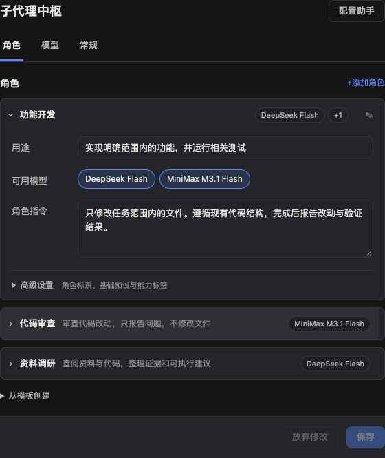
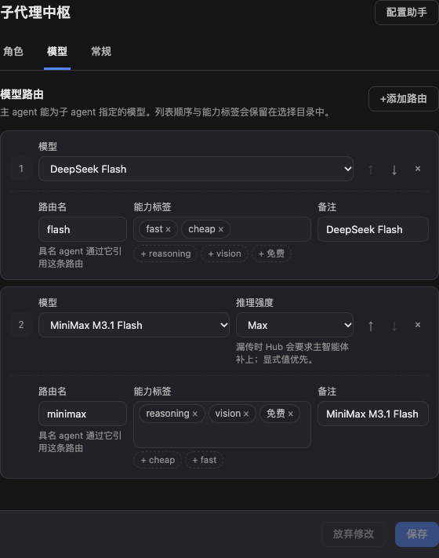

# 配置助手与角色设置

0.13.0 的设置页按 **角色、模型、常规** 分区。角色用单列折叠列表编辑，一次展开一个；名称按需修改，用途、可用模型和指令直接编辑，角色标识、基础预设与能力标签收在高级设置。

## 通过对话配置

先保存或放弃设置页中的草稿，再点击右上角 **配置助手**。也可以在新会话的模式列表里选择 **Hub 配置助手**（预设 ID：`hub-configurator`）。继续使用自己已配置的主模型即可。

例如：

> 读取当前 Hub 配置，帮我设计功能开发、代码审查、资料调研三个角色。优先使用已有的便宜模型，审查角色保持只读。先展示调整方案和配置预览，等我要求保存后再写入。

助手使用两个专用工具：

- `hub_configuration_read`：读取当前设置、模型与预设目录，以及 Team 入口的可用能力。
- `hub_configuration_update`：校验配置变更，默认只预览；明确保存时通过同一设置空间写入，并携带读取时的版本号。

该模式只提供专用配置工具，不附带通用文件或命令工具。它不能创建供应商账户或补齐模型凭据，也不会改变 DSH 源码。配置助手本身使用你选择的模型，因此会产生相应模型用量。

## 手动设置

1. 在 **模型** 中从 DSH 已有目录添加路由，填写路由标识、标签、备注与可选推理强度。
2. 在 **角色** 中添加角色，填写名称、用途、可用模型和指令。中文名称便于识别，角色标识供工具调用使用。
3. 在 **常规** 中设置并发上限、是否显示总览、是否托管官方委派设置。
4. 点击 **保存**，核对反馈，然后在新会话中使用新角色或新工具参数。

设置页和助手修改的是同一份配置。若另一编辑器已经保存更新，旧草稿会保留并提示冲突；放弃草稿可读取最新配置，再重新应用所需修改，不会直接覆盖另一方的更新。

## 独立子任务与 Team 角色

| 入口 | 角色行为 |
|---|---|
| 官方 `subagent` + `agent_preset: hub-agent-<id>` | 挂载具名角色预设，可使用其受支持的基础预设与工具组合 |
| 插件 `hub_spawn_teammate` + `role: <id>` | 应用角色指令和模型范围，工具组合仍从原生 Team 继承；自定义基础预设会被拒绝 |

`name` 是显示名称，`id` 是 Hub 角色标识，Team 创建参数 `name` 则是成员身份。这三项不要混用。Team 的模型选择、已绑定成员与重启恢复边界见 [Team 模型路由](team-model-routing.md)。

## 截图与验证范围

截图来自真实配置组件，使用 560px 宽的桌面设置内容区与隔离演示数据。截图不包含用户配置、凭据或真实对话，也不代表已在用户 Desktop 安装件中验收。配置工具、保存冲突与运行时能力另由自动回归验证，详情见[验收记录](ui-acceptance.md)。
