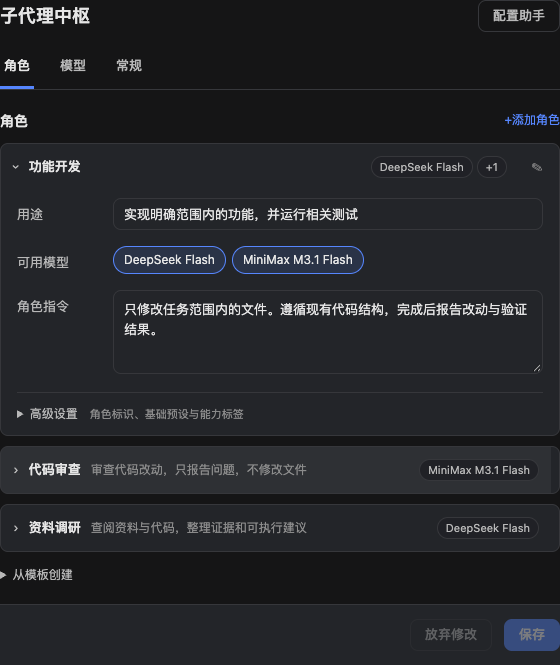
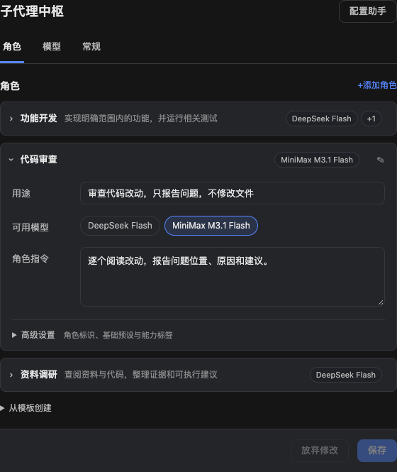
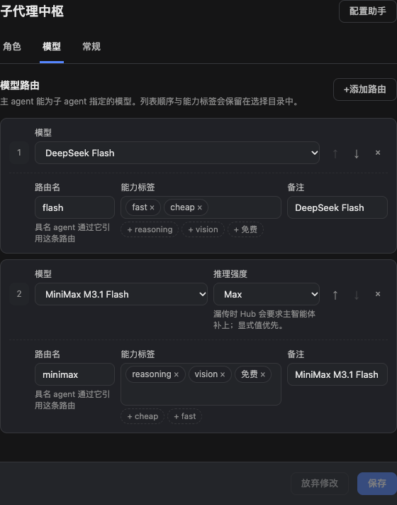
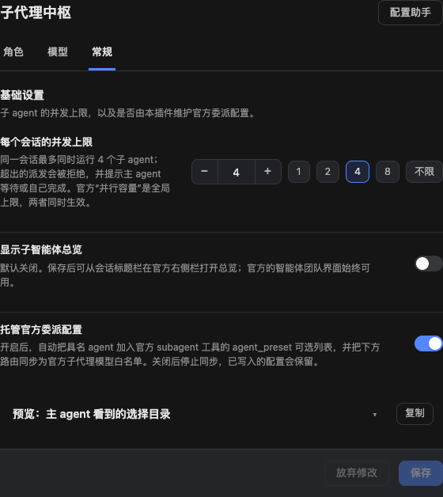
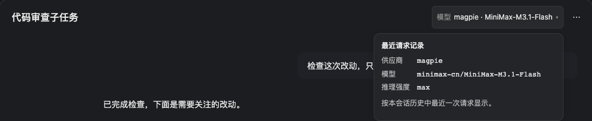
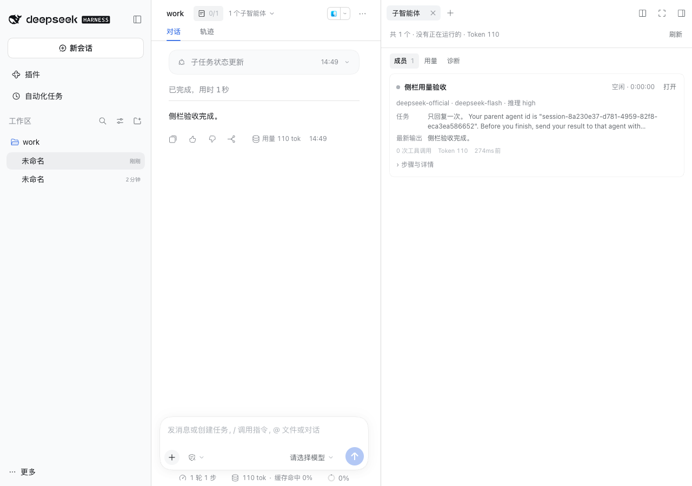
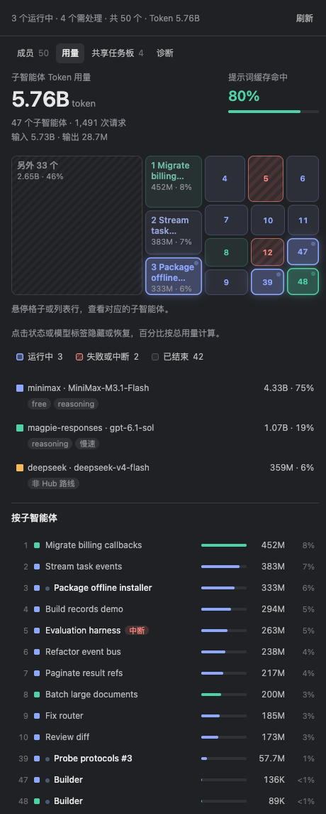
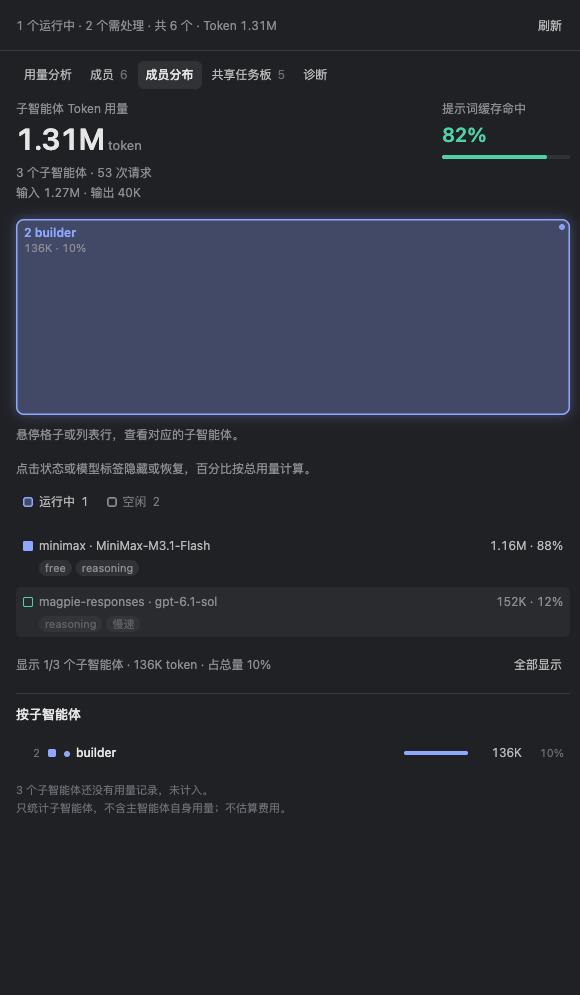
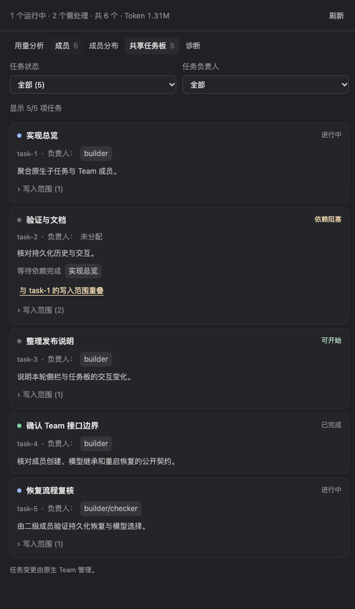
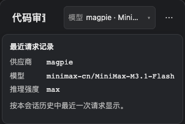

# Screenshots / 界面预览

0.13.0 的角色、模型、常规设置与用量筛选截图来自当前插件实际 Client 组件，以隔离演示数据渲染。设置内容区宽 560px，用量内容区宽 460px；它们是桌面组件截图。总览、原生侧栏用量与任务板截图来自隔离 DSH Web profile，使用原生右侧栏和脚本化模型回复，不调用外部模型。配置页只写入 fixture 内存，模型标识使用模拟的公开 Session face；没有使用真实用户 profile、私有对话或密钥。

它们展示真实组件的外观和交互。实际请求投影与派发行为由[运行时验收](model-badge-acceptance.md)另行验证。

## 角色与配置助手入口

[PNG 原图](assets/settings.png) · [展开高级设置](assets/settings-full.png)

## 展开的角色编辑器

[PNG 原图](assets/role-editor.png)

## 模型与常规设置

[PNG 原图](assets/models.png)

[PNG 原图](assets/general.png)

## 最近请求的模型

[PNG 原图](assets/model-badge.png)

## 子智能体总览

[PNG 原图](assets/overview-sidebar.png)

## 用量与直接点击筛选

[PNG 原图](assets/usage-filters.png)

[PNG 原图](assets/usage-filtered.png)。直接点击色块或整行即可隐藏和恢复，图表与列表同步；累计总量保持不变，并单列当前显示用量。没有额外勾选框。

这两张图使用实际组件、模拟侧栏容器及 50 个演示成员，不代表真实模型用量。另见[原生侧栏用量截图](assets/usage-sidebar.png)。

## 共享任务板

[PNG 原图](assets/task-board-sidebar.png)。任务由隔离环境的原生 Team 服务创建并持久化，模型回复使用测试插件；不涉及真实用户会话。任务板当前提供只读筛选与导航，写操作保留给原生 Team。

## 320px 窄屏

[PNG 原图](assets/model-badge-narrow.png)

## 复现与素材来源

渲染入口是[配置 fixture](../packages/subagent-hub/test/browser/render-fixture.mjs)、[模型标识 fixture](../packages/subagent-hub/test/browser/render-model-fixture.mjs)与[总览 fixture](../packages/subagent-hub/test/browser/render-overview-fixture.mjs)。用 Playwright 捕获组件区域，再无损压缩为 WebP；保留 PNG 下载版本。没有重绘或拼造界面控件。

Hero 使用 dsh-image-gen 0.9.2 的 Studio，通过已配置的 ChatGPT 订阅通道生成。它是项目插画。提示词、尺寸与生成记录见[素材说明](assets/README.md)。
