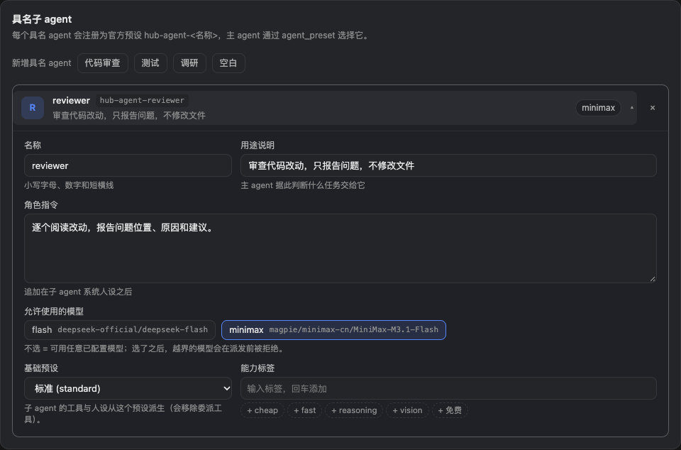
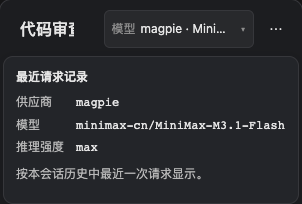

# Screenshots / 界面预览

这些截图来自当前插件的实际 Client 组件，以隔离的演示数据渲染。配置页只写入 fixture 内存，模型标识使用模拟的公开 Session face；没有使用真实用户 profile、私有对话或密钥。

它们展示真实组件的外观和交互。实际请求投影与派发行为由[运行时验收](model-badge-acceptance.md)另行验证。

## 模型与角色

[PNG 原图](assets/settings.png) · [完整配置页](assets/settings-full.png)

## 展开的角色编辑器

[PNG 原图](assets/role-editor.png)

## 最近请求的模型

[PNG 原图](assets/model-badge.png)

## 320px 窄屏

[PNG 原图](assets/model-badge-narrow.png)

## 复现与素材来源

渲染入口是[配置 fixture](../packages/subagent-hub/test/browser/render-fixture.mjs)与[模型标识 fixture](../packages/subagent-hub/test/browser/render-model-fixture.mjs)。用 Playwright 捕获组件区域，再无损压缩为 WebP；保留 PNG 下载版本。没有重绘或拼造界面控件。

Hero 使用 dsh-image-gen 0.9.2 的 Studio，通过已配置的 ChatGPT 订阅通道生成。它是项目插画。提示词、尺寸与生成记录见[素材说明](assets/README.md)。
