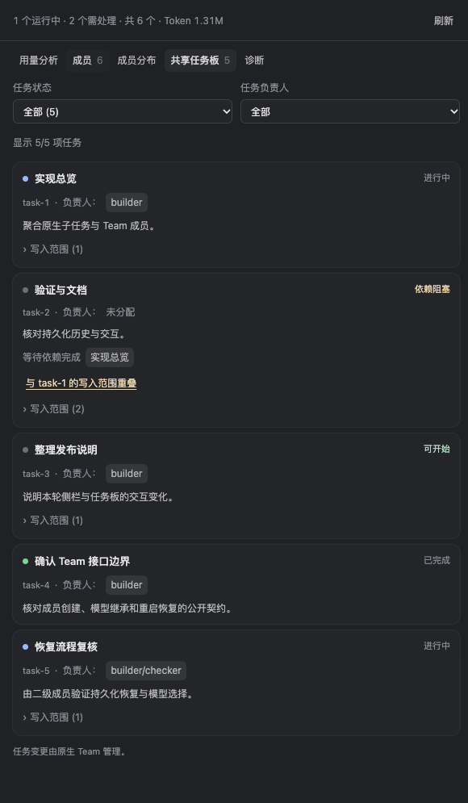

# Team 模型路由

从 0.13.0 起，Hub 通过公开插件接口提供 **`hub_spawn_teammate`**，为原生 Team 成员指定模型路由。Lead 可以使用任意已配置模型，成员可使用另一模型；不需要修改 DSH 源码或安装宿主补丁。

最低要求为 `@deepseek-ai/dsh` **0.2.2-rc.1**。需要启用原生 Team bundle、配置可用模型与 Hub 路由，并开始新会话。只有原生 Team、条件工具、本地子代理后端、模型选择及持久化接口齐备时，插件才暴露入口；不会向旧宿主或原生工具塞入未知参数。

## 选择正确的入口

| 入口 | 模型与角色 |
|---|---|
| 官方 `subagent` | 独立子任务；按实际工具 schema 选择 provider/model，具名角色使用 `agent_preset` |
| 原生 `spawn_teammate` | 保持原生行为；当前 fresh/fork 均继承 Lead 模型，没有独立模型输入 |
| 插件 `hub_spawn_teammate` | 为原生 Team 成员显式传 Hub `route` 与可选 `role`，支持 fresh/fork 历史 |

`context` 选择历史来源，`route` 选择模型。Lead 不绑定 GPT；已使用 Qoder 的 Qwen4 和 DeepSeek-Flash 分别担任 Lead 完成真实验证。

## 配置与使用

模型必须先在 DSH 中配置好并可正常调用。以下 provider/model 是占位示例，请替换为自己的精确值：

```yaml
- id: subagent-hub
  config:
    manageOfficialSettings: true
    maxConcurrent: 4
    routes:
      - id: worker-model
        provider: your-provider
        model: your-worker-model
        tags: [fast, cheap]
    agents:
      - id: builder
        name: 功能开发
        description: 完成明确范围内的实现并报告验证结果
        instructions: 只修改任务范围内的文件，遵循现有结构，完成后报告改动和验证。
        routes: [worker-model]
```

对 Lead 说：

> 用 hub_spawn_teammate 创建成员 implementation，route 使用 worker-model，role 使用 builder，context 使用 fresh。让它完成这项明确范围内的任务，并通过原生 Team 通道汇报。

实际工具参数示例：

```json
{
  "name": "implementation",
  "description": "完成指定功能并验证",
  "prompt": "实现任务说明中的功能，只修改指定文件，报告改动与验证结果。",
  "route": "worker-model",
  "role": "builder",
  "context": "fresh"
}
```

可选 `reasoning_effort` 必须是目标模型声明的有效值；省略时使用路线默认值。`role` 是 Hub 角色 ID，`name` 是 Team 成员身份，成员名称不会被推断成角色。也可通过[配置助手](configuration-assistant.md)维护路由和角色。

## 运行方式与边界

- **首次请求前绑定。** 插件通过公开子代理后端的 `prepareContinuable` 得到预留成员 ID，保存精确绑定，在等待式 `agent/created` 边界调用 `agent.model.select()`。完成持久化后才释放首次输入，不改请求对象、原生 descriptor 或会话格式。
- **消息与任务仍属原生 Team。** 发送消息、自动回传、任务板、成员生命周期与恢复继续由原生服务管理。绑定使用插件投影，按精确父/子 ID 恢复。
- **角色只应用指令与模型范围。** Team 工具组合仍继承原生环境；自定义 `basePreset` 会被拒绝，不能把角色选择当成完整 Agent Preset 切换。独立 `subagent` 仍使用现有具名预设能力。
- **先验证，再创建。** 目标模型、角色允许范围、有效推理强度、当前 Lead 捕获的子模型白名单与并发限制必须满足。跨模型 fork 还要求目标模型有有效的 `contextWindow`；缺少时在登记成员前拒绝，并提示使用 fresh 或修正容量配置。
- **已有成员保持绑定。** 删除/改换路线、删除角色或缩小角色模型范围会阻止后续请求；不会自动迁移已有成员。恢复原配置可继续原绑定，需要另一模型时新建成员。
- **并发与容量分别管理。** Hub 创建时检查实际正在运行的直接子成员，空闲驻留不占执行名额；原生 Team 成员容量独立生效。当前没有新增覆盖所有旧成员消息唤醒的全局调度器。
- **原生名单标签存在差异。** 当前 SDK 的 Team roster 从创建选项取模型标签，可能仍显示继承值；Hub 创建结果中的 `selection` 和成员请求记录才是选定/实际使用模型的证据。这一显示差异没有通过修改宿主修补。
- **持久化是前提。** 没有持久化监听器或写入失败时，插件拒绝继续创建。成员失败状态和资源清理仍由原生服务处理。

## 共享任务板



任务板支持状态/负责人组合筛选、空结果恢复、前置与冲突任务定位，以及通过当前 Team 名单打开真实负责人会话。就绪、阻塞和写入冲突直接展示；没有 readiness 证据时不猜测。当前客户端保持只读，认领、改派、完成等任务变更由原生 Team 工具执行。

## 验证证据

自动回归通过 **285 项单测、31 项普通运行时断言、8 项原生 Team 断言、58 项跨模型 Team 断言**及安装 SDK 插槽回归。58 项专项包括初始进程 41 项和第二个 OS 进程恢复 17 项，使用模拟适配器及拦截模型流，不访问真实供应商。

```bash
HUB_ROUTED_TEAM_E2E=true bash packages/subagent-hub/test/e2e/run.sh
```

此专项已加入根目录 `test.sh`，在独立临时 `DSH_HOME` 中运行，覆盖首次请求、fresh/fork、角色与思考强度、多个供应商 Lead/成员、消息唤醒、身份/选模恢复、无效输入创建前拒绝、绕过后端拒绝和角色范围变更后的保护。

另通过现有 Magpie Qoder 通道直接调用真实模型，**未替换模型流**：

| 场景 | 结果 |
|---|---|
| Qwen4-Max-Preview Lead → DeepSeek-Flash fresh 成员、Qwen4 fork 成员 | 角色校验词与结果正确，Flash 唤醒后保持原模型 |
| DeepSeek-Flash Lead 自主调用 Hub 工具 → Qwen4 成员 → 原生回传 → Lead 汇总 | 完整流程成功，包含原生等待与名单工具 |

最终两条真实流程共 **19 项检查通过**。模型名称与路由来自当前配置，未独立认证网关下游模型身份。校准经过、调用数量及验证范围见[验收记录](ui-acceptance.md)。真实供应商调用不属于 CI 或默认回归。

**仍待验收：** Desktop 实际安装件、插件热重载（HMR）、其它供应商协议、真实调用下的跨进程恢复及长历史压缩边界。当前跨进程恢复只有模拟流专项证据。先前宿主源码扩展实验已撤回，不属于发布包或安装前提。

实现见 [Team 运行模块](../packages/subagent-hub/lib/team-routing.js)、[绑定投影](../packages/subagent-hub/lib/team-routing-state.js)与[原生继承守卫回归](../packages/subagent-hub/test/team-guard.test.js)。
